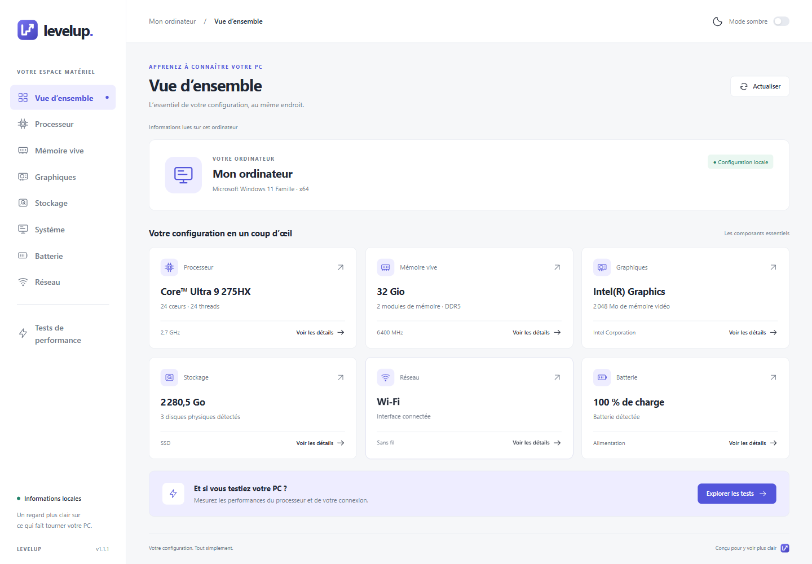
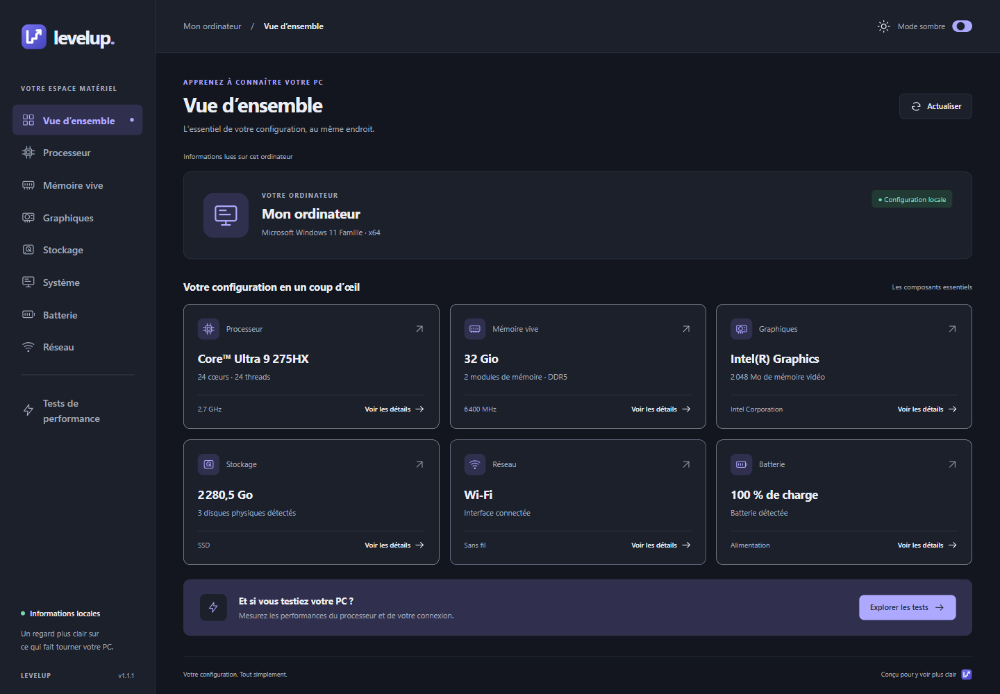

# Levelup

**Votre PC, en clair.** Levelup est une application de bureau pour explorer les composants de votre ordinateur et tester ses performances dans une interface en français.

[Télécharger pour Windows x64](https://github.com/MonkeyTime/levelup/releases/latest/download/Levelup-Setup.exe) · [Toutes les releases](https://github.com/MonkeyTime/levelup/releases) · [Signaler un problème](https://github.com/MonkeyTime/levelup/issues)



## Installer sur Windows

1. Téléchargez `Levelup-Setup.exe` depuis la dernière release.
2. Lancez l’installateur puis ouvrez Levelup.

Compatible avec Windows 10 et 11, en 64 bits x64. Node.js n’est pas nécessaire pour utiliser l’application installée. L’installateur n’est pas signé numériquement ; Windows peut afficher un avertissement à son ouverture.

## Un thème pour chaque préférence

Le mode clair est activé par défaut. Le switch **Mode sombre** mémorise votre choix pour les prochains démarrages.

<details>
<summary>Voir le mode sombre</summary>



</details>

## Identité visuelle

Le logo Levelup associe un L, des marches et une flèche montante dans les tons violets de l’interface. `assets/levelup.svg` est sa source vectorielle. Il apparaît dans la navigation et le pied de page ; les pictogrammes SVG suivent le thème choisi.

Après une modification du SVG, `npm run icons` régénère le PNG de 512 px et l’ICO contenant neuf tailles de 16 à 256 px. Ils sont utilisés pour la fenêtre, la barre des tâches, l’exécutable, les raccourcis Windows et l’installateur. Relancez `npm run make -- --platform=win32 --arch=x64` pour intégrer ces icônes aux exécutables.

## Démarrer depuis les sources

Prérequis : Node.js 22.13 ou supérieur (Node.js 24 LTS conseillé).
L’installation télécharge le binaire Electron via le script `install-electron`.

```sh
npm install
npm start
```

## Fonctionnalités

- Vue d’ensemble du processeur, de la mémoire, des cartes graphiques, du stockage, du réseau et de la batterie.
- Fiches détaillées par composant, actualisation et gestion des informations indisponibles.
- Thème clair par défaut et mode sombre mémorisé sur cet ordinateur.
- Test CPU exécuté dans un worker pour garder l’interface disponible.
- Estimations de téléchargement et d’envoi avec gestion des erreurs et délai maximal de 25 secondes.

Les informations matérielles sont lues localement. Les tests réseau ne démarrent qu’au clic et communiquent avec https://httpbin.org : téléchargement jusqu’à 500 Ko, envoi de 500 Ko de données synthétiques. Les débits incluent le temps de réponse du serveur et restent indicatifs. L’indice CPU est un indice local où une valeur plus élevée indique une exécution plus rapide ; il ne se compare pas aux scores de l’ancienne version. Aucun test disque n’est implémenté.

## Vérification

```sh
npm test
```

Les tests vérifient les octets effectivement transférés, le sens des transferts et les erreurs HTTP/réseau, sans accès Internet.

## Dépendances et sécurité

`package-lock.json` fixe les versions installées. Pour reproduire exactement cette installation :

```sh
npm ci
npm audit
```

Electron utilise la version 45.2.1. Les bibliothèques inutilisées `bootstrap`, `network-speed` et l’ancien `electron-rebuild` ont été retirées. Forge utilise son propre `@electron/rebuild`.

Les substitutions `overrides` imposent `glob` 14.0.3 pour `@electron/asar` et `minimatch` 11.0.4 pour corriger les alertes de déni de service. La substitution globale de `minimatch` couvre aussi la chaîne `electron-winstaller → temp → rimraf → glob`. Ces outils anciens peuvent encore afficher des avertissements de dépréciation ; `npm audit` vérifie les alertes de sécurité. La création et l’extraction d’archives ASAR ainsi que la génération Windows sont vérifiées avec ces versions.

Pour créer le dossier de l’application Windows :

```sh
npm run package -- --platform=win32 --arch=x64
```

Le résultat se trouve dans `out/`.

Pour générer l’installateur Windows avec Squirrel :

```sh
npm ci
npm run make -- --platform=win32 --arch=x64
```

L’installateur se trouve dans `out/make/squirrel.windows/x64/Levelup-Setup.exe`. Forge 8 ne propose plus la commande `import` : les scripts et les makers sont déjà déclarés dans `package.json` et `forge.config.cjs`.

Avec npm 12, `allowScripts` autorise le script d’installation d’`electron-winstaller`, nécessaire pour sélectionner le binaire 7-Zip de la machine de compilation.
